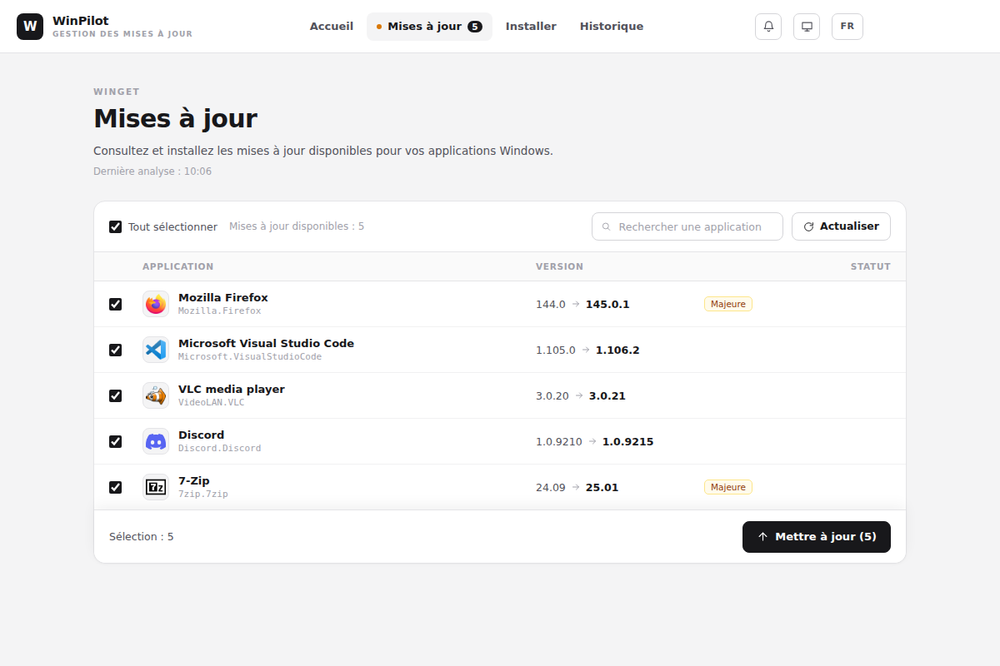

# WinPilot

Application de bureau pour Windows qui garde vos applications à jour et les installe en quelques clics, avec [winget](https://learn.microsoft.com/windows/package-manager/winget/).

**[Télécharger la dernière version](https://github.com/Lasdepic/winPilot-releases/releases/latest)** · [Site web](https://lasdepic.github.io/winPilot-releases/)

## Fonctionnalités

- **Mises à jour** : voyez d'un coup d'œil ce qui peut être mis à jour, puis mettez tout à jour ou seulement ce que vous choisissez.
- **Installation** : cochez des applications dans un catalogue classé par catégorie, ou cherchez-en d'autres dans winget.
- **Historique** : retrouvez les dernières opérations effectuées.
- **Mode arrière-plan** : WinPilot vérifie les mises à jour depuis la zone de notification et vous prévient.
- **Mise à jour de WinPilot** : l'application se met à jour elle-même, et c'est vous qui choisissez quand l'installer.
- **Interface** en français et en anglais.

## Captures d'écran

### Mises à jour

### Installer des applications

### Historique

*Captures réalisées avec des données d'exemple.*

## Installation

1. Téléchargez `WinPilot-Setup-<version>.exe` depuis la [dernière version](https://github.com/Lasdepic/winPilot-releases/releases/latest).
2. Lancez l'installeur.

L'installeur n'est pas signé : Windows SmartScreen peut afficher un avertissement. Cliquez alors sur **Informations complémentaires**, puis sur **Exécuter quand même**.

## Prérequis

Windows 10 ou 11 avec winget (« App Installer »).

## À propos de ce dépôt

Ce dépôt héberge uniquement les versions publiées de WinPilot. L'application y cherche ses mises à jour.
