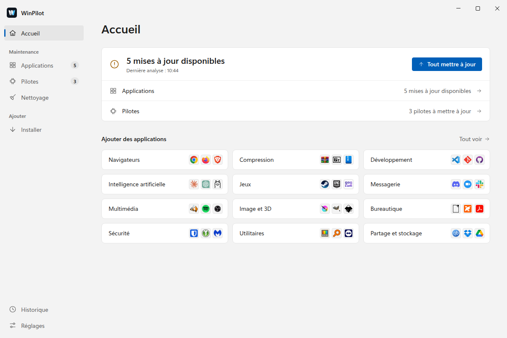
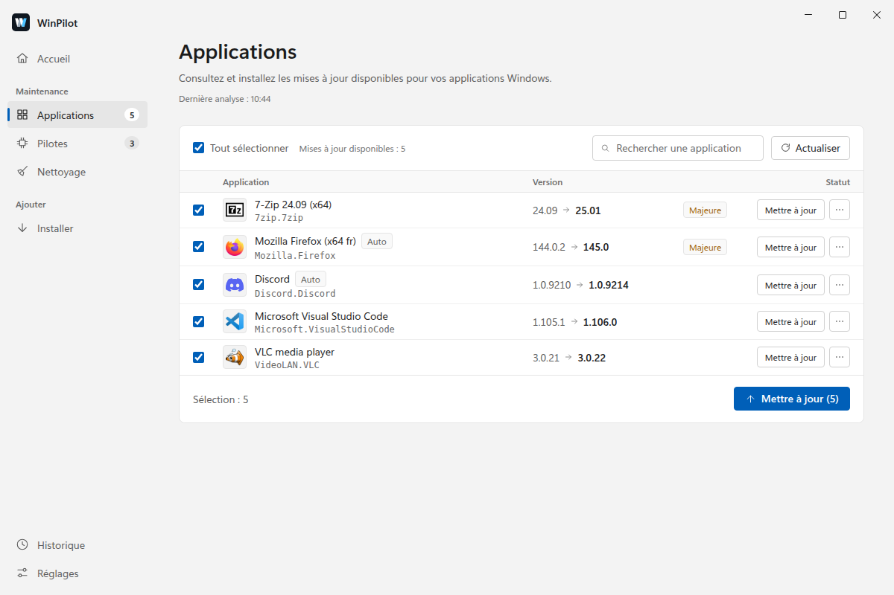
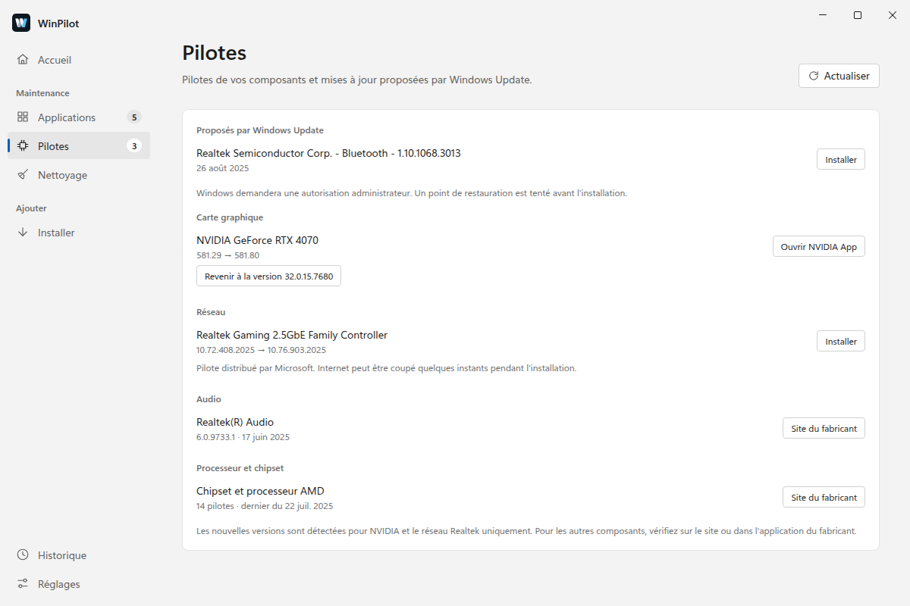
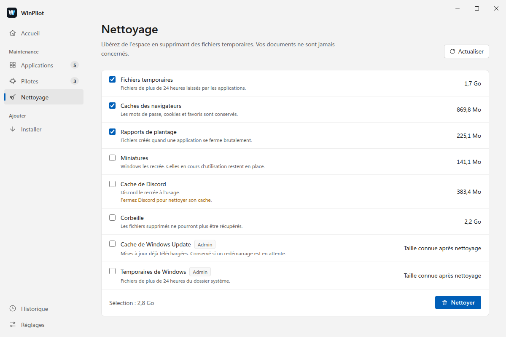
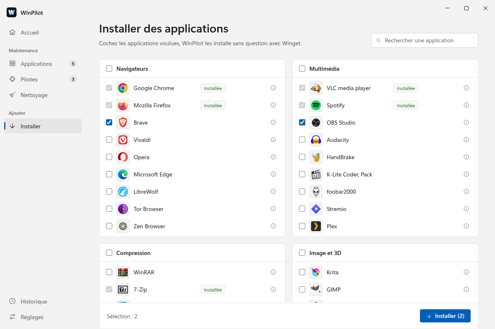
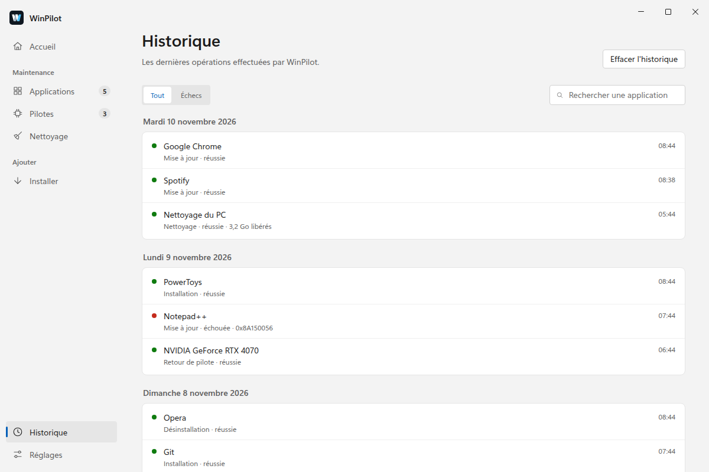

# WinPilot

Application de bureau pour Windows qui garde votre PC à jour : elle met à jour vos applications avec [winget](https://learn.microsoft.com/windows/package-manager/winget/), surveille vos pilotes et libère de l'espace disque, sans ligne de commande.

**[Télécharger la dernière version](https://github.com/Lasdepic/winPilot-releases/releases/latest)** · [Site web](https://lasdepic.github.io/winPilot-releases/)

## Fonctionnalités

- **Applications** : voyez ce qui peut être mis à jour, lisez les notes de version, puis mettez tout à jour ou seulement ce que vous choisissez. Les versions majeures sont signalées, et vous pouvez ignorer une application ou une version.
- **Pilotes** : WinPilot liste les pilotes de vos composants et ceux que propose Windows Update. Il détecte les nouvelles versions pour NVIDIA et le réseau Realtek, tente un point de restauration avant chaque installation et permet de revenir au pilote précédent.
- **Nettoyage** : fichiers temporaires, caches des navigateurs, rapports de plantage, miniatures, corbeille. La place gagnée est affichée avant de confirmer, et vos documents ne sont jamais concernés.
- **Installation** : cochez des applications dans un catalogue de 99 applications en 12 catégories, ou cherchez-en d'autres dans winget.
- **Mises à jour automatiques** : depuis la zone de notification, WinPilot vérifie toutes les 6 heures. Les applications que vous approuvez se mettent à jour seules, PC sur secteur et hors versions majeures.
- **Historique** : retrouvez les dernières opérations, classées par jour, avec un filtre pour les échecs.
- **Mise à jour de WinPilot** : l'application se met à jour elle-même, et c'est vous qui choisissez quand l'installer.
- **Interface** au style de Windows 11, en clair ou en sombre, avec la couleur d'accent de Windows, en français et en anglais.

## Captures d'écran

### Applications

### Pilotes

### Nettoyage

### Installer des applications

### Historique

*Captures réalisées avec des données d'exemple.*

## Installation

1. Téléchargez `WinPilot-Setup-<version>.exe` depuis la [dernière version](https://github.com/Lasdepic/winPilot-releases/releases/latest).
2. Lancez l'installeur.

L'installeur n'est pas signé : Windows SmartScreen peut afficher un avertissement. Cliquez alors sur **Informations complémentaires**, puis sur **Exécuter quand même**.

## Prérequis

Windows 10 ou 11 avec winget (« App Installer »), présent d'origine sur Windows 11.

## Vos données

Pas de compte ni de télémétrie : vos réglages et votre historique restent sur votre PC. WinPilot se connecte à Internet pour winget, pour ses propres mises à jour sur GitHub, et pour les pilotes (Windows Update, catalogue Microsoft Update et site de NVIDIA).

## À propos de ce dépôt

Ce dépôt héberge uniquement les versions publiées de WinPilot et son site. L'application y cherche ses mises à jour.
